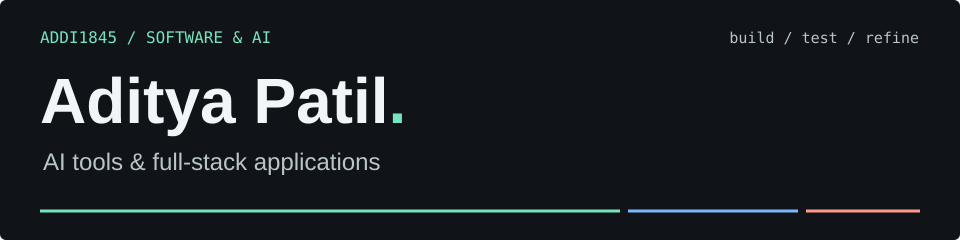

<picture>
  <source media="(max-width: 600px)" srcset="assets/header-mobile.svg">
  
</picture>

I build tools for **reliable AI agents, explainable ranking, and structured data workflows**. My projects connect interfaces with APIs, evaluation logic, and data validation.

  <strong>Open to internships &amp; software engineering opportunities.</strong> 
  Learning by building, testing, and improving working software.

  <a href="#selected-projects"><strong>Selected projects</strong></a> &nbsp; &middot; &nbsp;
  <a href="#-tech-stack">Tech stack</a> &nbsp; &middot; &nbsp;
  <a href="https://github.com/Addi1845?tab=repositories">All repositories</a>

## 💻 Tech Stack

## Selected projects

<table>
  <tr>
    <td width="50%" valign="top">
      
      <h3><a href="https://github.com/Addi1845/AgentCrash">AgentCrash</a></h3>
      
Tests an e-commerce support agent against <strong>15 weighted scenarios</strong> in an isolated sandbox, with findings, run history, and re-tests.

      
Sandboxed evaluation &middot; Evidence reports

      <a href="https://github.com/Addi1845/AgentCrash#readme"><strong>Explore project &rarr;</strong></a>
    </td>
    <td width="50%" valign="top">
      
      <h3><a href="https://github.com/Addi1845/specgraph-ai">SpecGraph AI</a></h3>
      
Product-data enrichment with evidence, confidence, a review queue, and a <strong>252-column CSV export</strong>. Uses deterministic sample enrichments.

      
Data validation &middot; Review workflows

      <a href="https://github.com/Addi1845/specgraph-ai#readme"><strong>Explore project &rarr;</strong></a>
    </td>
  </tr>
  <tr>
    <td width="50%" valign="top">
      
      <h3><a href="https://github.com/Addi1845/Recruite.ai">Recruite.ai</a></h3>
      
Candidate ranking with <strong>component-level score explanations</strong>, a Python scoring pipeline, and multiprocessing. Built for a data and AI challenge.

      
Python &middot; Scoring pipelines

      <a href="https://github.com/Addi1845/Recruite.ai#readme"><strong>Explore project &rarr;</strong></a>
    </td>
    <td width="50%" valign="top">
      
      <h3><a href="https://github.com/Addi1845/PrivacyShield_AI">PrivacyShield</a></h3>
      
A Chrome extension for <strong>reviewing context before sharing with AI</strong>, masking sensitive content during tab presentations, and sanitizing text and screenshots.

      
Chrome extension &middot; Context review

      <a href="https://github.com/Addi1845/PrivacyShield_AI#readme"><strong>Explore project &rarr;</strong></a>
    </td>
  </tr>
</table>

---

**Also exploring:** [FairLens](https://github.com/Addi1845/FairLens), a browser-based prototype for exploring group-level differences in loan approval data.

  <a href="https://github.com/Addi1845?tab=repositories"><strong>Explore all my projects</strong></a>

