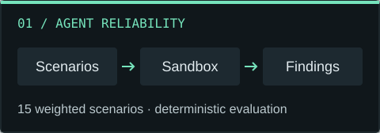
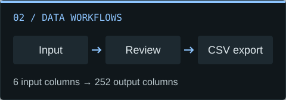
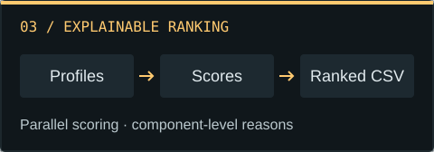
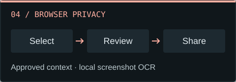

<picture>
  <source media="(prefers-reduced-motion: reduce) and (max-width: 600px)" srcset="assets/header-mobile-static.svg">
  <source media="(prefers-reduced-motion: reduce)" srcset="assets/header-static.svg">
  <source media="(max-width: 600px)" srcset="assets/header-mobile.svg?v=2">
  
</picture>

  
  

I build **AI tools and full-stack applications** with Python, TypeScript, and React. My work focuses on making systems easier to trust: testing agent behavior, explaining rankings, validating data, and reviewing what gets shared with AI.

I learn by taking an idea through the whole workflow: **interface, API, data, and verification**. I'm especially interested in AI tooling, browser privacy, and software that turns complex processes into clear, usable experiences.

  <a href="#selected-projects"><strong>Projects</strong></a> &nbsp; / &nbsp;
  <a href="#-tech-stack"><strong>Tech stack</strong></a> &nbsp; / &nbsp;
  <a href="#engineering-notes"><strong>Engineering notes</strong></a> &nbsp; / &nbsp;
  <a href="#lets-connect"><strong>Connect</strong></a>

## Selected projects

<table>
  <tr>
    <td width="50%" valign="top">
      
      <h3><a href="https://github.com/Addi1845/AgentCrash">AgentCrash</a></h3>
      
A deterministic reliability engine for an e-commerce support agent.

      <ul>
        <li><strong>15 weighted scenarios</strong> spanning normal, edge, failure, and adversarial cases.</li>
        <li>Event evidence, scoring, run history, and re-tests backed by SQLite.</li>
      </ul>
      
<code>TypeScript</code> <code>React</code> <code>Fastify</code> <code>SQLite</code>

      
Demo scope: isolated fixtures; no real customer or payment systems.

      
<a href="https://github.com/Addi1845/AgentCrash#readme"><strong>Code &amp; setup &rarr;</strong></a> &nbsp; <a href="https://github.com/Addi1845/AgentCrash/blob/main/PROJECT_SPEC.md">Specification</a>

    </td>
    <td width="50%" valign="top">
      
      <h3><a href="https://github.com/Addi1845/specgraph-ai">SpecGraph AI</a></h3>
      
A product-data enrichment demo built around an exact delivery contract.

      <ul>
        <li>A six-column input flows through a <strong>12-step mock pipeline</strong>.</li>
        <li>Evidence, confidence, and a review queue lead to a validated <strong>252-column CSV</strong>.</li>
      </ul>
      
<code>Next.js</code> <code>TypeScript</code> <code>Data contracts</code>

      
Demo scope: deterministic sample enrichments; runs without API keys.

      
<a href="https://github.com/Addi1845/specgraph-ai#readme"><strong>Code &amp; setup &rarr;</strong></a> &nbsp; <a href="https://github.com/Addi1845/specgraph-ai/blob/main/ARCHITECTURE.md">Architecture</a>

    </td>
  </tr>
  <tr>
    <td width="50%" valign="top">
      
      <h3><a href="https://github.com/Addi1845/Recruite.ai">Recruite.ai</a></h3>
      
An inspectable candidate-ranking pipeline built for a data and AI challenge.

      <ul>
        <li>Parallel processing, TF-IDF matching, and configurable CPU workers.</li>
        <li><strong>Component-level explanations</strong> and ranked CSV output with reasons.</li>
      </ul>
      
<code>Python</code> <code>Multiprocessing</code> <code>TF-IDF</code>

      
Challenge scope: heuristic rankings that require evaluation and human review.

      
<a href="https://github.com/Addi1845/Recruite.ai#readme"><strong>Code &amp; setup &rarr;</strong></a> &nbsp; <a href="https://github.com/Addi1845/Recruite.ai/blob/main/rank.py">Scoring pipeline</a>

    </td>
    <td width="50%" valign="top">
      
      <h3><a href="https://github.com/Addi1845/PrivacyShield_AI">PrivacyShield</a></h3>
      
A Chrome extension for reviewing AI context and preparing browser tabs for presentations.

      <ul>
        <li><strong>Ask privately:</strong> select, sanitize, and approve the exact context packet.</li>
        <li><strong>Present safely:</strong> blur or hide sensitive content, with local screenshot OCR.</li>
      </ul>
      
<code>TypeScript</code> <code>React</code> <code>Chrome MV3</code> <code>Tesseract.js</code>

      
Current scope: browser tabs and snapshots; review remains essential.

      
<a href="https://github.com/Addi1845/PrivacyShield_AI#readme"><strong>Code &amp; setup &rarr;</strong></a> &nbsp; <a href="https://github.com/Addi1845/PrivacyShield_AI/blob/main/docs/architecture.md">Architecture</a>

    </td>
  </tr>
</table>

**Also exploring:** [FairLens](https://github.com/Addi1845/FairLens), a browser-based prototype for inspecting group-level differences in loan approval data.

[Browse all repositories &rarr;](https://github.com/Addi1845?tab=repositories)

## 💻 Tech Stack

Technologies used across my projects, grouped by where they fit.

### Languages

### Frontend & interfaces

### Backend & data

### Testing & validation

## Engineering notes

- **Keep behavior inspectable.** [AgentCrash](https://github.com/Addi1845/AgentCrash) records execution evidence and findings. [Recruite.ai](https://github.com/Addi1845/Recruite.ai) exposes scoring components and reasons behind each result.
- **Validate the boundaries.** [SpecGraph AI](https://github.com/Addi1845/specgraph-ai/blob/main/ARCHITECTURE.md) checks input and output contracts and preserves source identifiers through export.
- **Make privacy a workflow.** [PrivacyShield](https://github.com/Addi1845/PrivacyShield_AI/blob/main/docs/user-guide.md) asks users to review context before sharing it and keeps screenshot OCR on device.
- **Verify the full experience.** My TypeScript projects use type checks, linting, and tests; PrivacyShield also includes browser checks and a bundle audit. [View its test evidence](https://github.com/Addi1845/PrivacyShield_AI/blob/main/docs/test-report.md).

## Let's connect

I'm open to **internships and software engineering opportunities**, especially in AI tools and full-stack development.

[Connect on LinkedIn](https://www.linkedin.com/in/adityapatil-web/) &nbsp; &middot; &nbsp; [Explore my work](https://github.com/Addi1845?tab=repositories)
